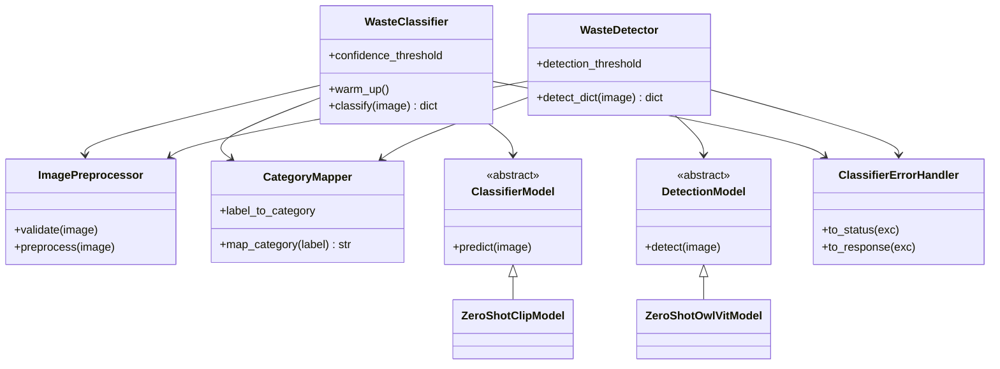

# AI-Powered_Waste_Sorting_and_Recycling_Assistant_Team_26
Python Compact Course Capstone Project


## Subsystem 2: Backend & Application Integration
## Overview

The **Backend & Application Integration** subsystem is responsible for coordinating the communication between the web interface, ML image classifier, data management system, and AI guidance service.

It acts as the central orchestration layer of the application. It receives the uploaded image, sends it to the classifier, validates the classification result, requests disposal guidance, stores the classification result, and prepares the final structured response for the frontend.

## Responsibilities

The backend subsystem is responsible for:

- Receiving image data from the web interface.
- Communicating with the ML image classifier.
- Validating and normalizing classifier results.
- Handling invalid or unusable images.
- Requesting waste-disposal guidance for the classified item.
- Storing classification results through the database management subsystem.
- Combining classification and guidance information.
- Returning a structured response to the frontend.
- Handling integration errors between the different subsystems.

## Architecture

The main processing flow is:

```text
Web Interface
      |
      v
AnalysisService
      |
      +--------------------+
      |                    |
      v                    v
ML Classifier     ClassificationResultHandler
      |                    |
      |                    v
      |             Validated Result
      |                    |
      +----------->--------+
                   |
                   v
            GuidanceService
                   |
                   v
            DatabaseManager
                   |
                   v
          ResponseComposer
                   |
                   v
              Frontend
```

## Main Components

### `AnalysisService`

`AnalysisService` is the main orchestration component of the backend.

It coordinates the complete image-analysis workflow:

1. Receives the image data.
2. Sends the image to the ML classifier.
3. Passes the classifier result to `ClassificationResultHandler`.
4. Requests disposal guidance from `GuidanceService`.
5. Saves the classification through `DatabaseManager`.
6. Passes the collected information to `ResponseComposer`.
7. Returns the final response.

### `ClassificationResultHandler`

`ClassificationResultHandler` validates and normalizes the result received from the ML classifier.

It checks:

- Classification status.
- Waste label.
- Confidence score.
- Waste category.
- Region.

It also handles the `invalid_image` status when the uploaded image cannot be used for classification.

The default region is **Dortmund**.

### `ResponseComposer`

`ResponseComposer` combines the classification result, disposal guidance, and database classification ID into a structured response that can be returned to the frontend.

## Error Handling

The backend uses custom exceptions to handle integration failures:

```text
BackendError
├── ClassifierIntegrationError
├── InvalidImageError
├── InvalidClassificationResultError
├── GuidanceIntegrationError
└── ResponseCompositionError
```

This allows different types of failures to be identified and handled separately.

## Classifier Integration

The backend expects the ML classifier to return a structured result such as:

```json
{
    "status": "completed",
    "label": "plastic bottle",
    "category": "recyclable",
    "confidence": 0.94
}
```

For an invalid image, the classifier can return:

```json
{
    "status": "invalid_image",
    "message": "The uploaded image is not suitable for classification."
}
```

The backend validates this result before continuing with the remaining processing steps.

## Database Integration

The backend does not directly perform SQL operations.

Instead, it communicates with the `DatabaseManager` provided by the **Data Management & AI Guidance** subsystem.

After successful classification, the backend stores relevant classification information such as:

- Label
- Confidence
- Status
- Region

The database operation returns a `classification_id`, which is then included in the final response.

## Guidance Integration

After classification, the backend sends the normalized waste label and region to the `GuidanceService`.

The guidance service retrieves the appropriate disposal guidance from the data-management subsystem and can use AI assistance when required.

The backend then combines:

```text
Classification Result
        +
Disposal Guidance
        +
Classification ID
        |
        v
Final Structured Response
```

## Example Backend Response

A successful response can contain information such as:

```json
{
    "classification": {
        "label": "plastic bottle",
        "category": "recyclable",
        "confidence": 0.94,
        "region": "Dortmund"
    },
    "guidance": {
        "bin_type": "Yellow Bin",
        "instruction": "Dispose of the empty plastic bottle in the appropriate recycling container."
    },
    "classification_id": 15
}
```

## Testing

The backend subsystem is tested using `pytest`.

Tests cover:

- Valid classifier results.
- Invalid classifier results.
- Invalid images.
- Missing labels.
- Invalid confidence values.
- Guidance integration.
- Classification storage.
- Response composition.
- Complete backend integration flow.

Run the backend tests with:

```bash
python -m pytest -v tests/test_backend.py
```

## Files

The main backend files are:

```text
backend/
├── __init__.py
├── analysis_service.py
├── classification_result_handler.py
├── response_composer.py
└── exceptions.py
```

## Subsystem Dependencies

The backend integrates with:

- **Web Interface** — provides uploaded images and receives the final response.
- **ML Image Classification** — provides the predicted waste label and confidence.
- **Data Management & AI Guidance** — provides disposal guidance and database operations.

The backend therefore serves as the integration layer connecting the major components of the application.


## Subsystem 3: Image Classifier & Object Detector (Azam Rahmani)

Answers three questions for every uploaded photo: **what is it, where is it, and how sure are we.**
Two pretrained, zero-shot models from Hugging Face, so no training is needed:

| Class | Model | Returns |
|---|---|---|
| `WasteClassifier` | CLIP `openai/clip-vit-base-patch32` | one label per photo (used by the web app) |
| `WasteDetector` | OWL-ViT `google/owlvit-base-patch32` | every item with a bounding box `[x, y, width, height]` |

The 23 labels are exactly item labels of `data/waste_guidance.json`, so a predicted label goes
straight into `DatabaseManager.get_rule(label)`.

```python
from classifier import WasteClassifier

classifier = WasteClassifier()
classifier.warm_up()                     # once at app start (downloads ~600 MB the first time)
result = classifier.classify(image_bytes)
# {"status": "completed", "label": "glass jar", "category": "recyclable",
#  "confidence": 0.92, "message": "", "inference_ms": 140.3}
```

| status | meaning | web app (`app.py`) |
|---|---|---|
| `completed` | confident prediction (confidence >= 0.5) | result shown and saved |
| `uncertain` | low confidence | result shown and saved as uncertain |
| `invalid_image` | empty, broken, too large or unsupported file | 400 with the message |
| `error` | the model failed | 503 "Classification service unavailable" |

The classifier never raises: `ClassifierErrorHandler` (`classifier/exceptions.py`) turns every
exception into one of these statuses, logs unexpected errors and hides internal details.
Images stay in memory and are never saved to disk.



**Setup:** `pip install -r requirements.txt` (torch and transformers are only needed for real
predictions; without them `app.py` falls back to a placeholder result).
**Try one photo:** `python scripts/classify_image.py photo.jpg` ·
**Accuracy on a photo folder:** `python scripts/evaluate.py test_images/`
**Tests:** `tests/test_preprocessor.py`, `test_category_mapper.py`, `test_waste_classifier.py`,
`test_waste_detector.py`, `test_evaluator.py`, `test_classifier_errors.py`, `test_classifier_api.py`
(84 tests, fake models, no download). Details: [docs/CLASSIFIER.md](docs/CLASSIFIER.md).


## Subsystem 4: Data Management & AI Guidance (Ha Le Thu)

Stores every classification result, the Dortmund disposal rules and the AI answers,
and gives the statistics for the municipality dashboard. Full details: [docs/DATABASE.md](docs/DATABASE.md).

| File | Purpose |
|------|---------|
| `database/db.py` | `DatabaseManager`, the only file with SQL (SQLite or MySQL, 8 tables) |
| `database/models.py` | `WasteCategory`, `WasteItem`, `DisposalRule` (encapsulation, validation) |
| `database/exceptions.py` | `DataManagementError`, `InvalidDataError`, `ItemNotFoundError`, `DatabaseConnectionError` |
| `database/guidance.py` | `GuidanceService`: AI explanation and follow-up questions, with cache, daily limit and fallback |
| `database/schema_sqlite.sql`, `schema_mysql.sql` | Database schema |
| `data/waste_guidance.json` | 72 Dortmund rules; labels match the classifier labels exactly |
| `demo_data_management.py`, `demo_ai_guidance.py`, `demo_dashboard_data.py` | Demos |
| `tests/` | Unit tests (AI is mocked) |
| `docs/class_diagram_data.png`, `.puml` | UML class diagram of this subsystem (matches the code) |

### API for the other subsystems

```python
from database.db import DatabaseManager
from database.guidance import GuidanceService

db = DatabaseManager()
db.initialize()                                   # tables + Dortmund rules
ai = GuidanceService(db)

# Backend (Sai) - after the classifier (Azi) returns a result
rule = db.get_rule("glass jar")                   # bin_type, instruction, category, is_deposit
text = ai.explain("glass jar", rule=rule)         # {"explanation", "source", "ai_generated"}
cid = db.save_classification("glass jar", 0.92, status="completed")
db.save_feedback(cid, is_correct=False, correct_label="glass bottle")
ai.ask("Do I need to wash it?", label="glass jar")  # {"answer", "source", "ai_generated"}

# Dashboard (Kanika)
db.get_classification_records(region="Dortmund", limit=50)   # newest first, region=None -> all
db.get_stats(region="Dortmund")
```

`get_stats()` returns `total_items`, `by_category`, `category_percentages`,
`recycling_rate` (0-1), `per_day`, `top_items`, `region_counts`,
`uncertain_count` and `wrong_feedback_count`.

Flask routes in `web_interface_dashboard/app.py`: `POST /analyse`, `POST /feedback`,
`POST /ask`, `GET /dashboard` (Kanika's HTML dashboard page, built on `get_stats()`).

### Setup

```bash
python3 -m venv venv
source venv/bin/activate              # Windows: venv\Scripts\activate
pip install -r requirements.txt
cp .env.example .env                  # then add your AI key (see below)
```

### Run

```bash
python demo_dashboard_data.py         # optional: 200 example results for the dashboard
cd web_interface_dashboard
flask --app app run --port 5050       # open http://127.0.0.1:5050
```

On macOS port 5000 is often used by AirPlay Receiver, so we use port 5050.
Useful URLs: `/` (upload a photo), `/dashboard` (municipality dashboard).

### Database file

`database/waste.db` is created automatically on the first start (8 tables + 72 Dortmund rules
from `data/waste_guidance.json`). It is not committed to Git.
To load changed rules from the JSON file, delete `database/waste.db` and start again.
To use MySQL instead, set `DB_ENGINE=mysql` and the `DB_*` values in `.env`.

### AI key (free option)

Without an AI key the app still works: it shows the official rule as explanation.
For real AI answers, put a key in `.env`. Free option with Google Gemini:

1. Create a key at <https://aistudio.google.com> (Get API key, no credit card needed).
2. In `.env`:
   ```
   AI_API_KEY=your-gemini-key
   AI_BASE_URL=https://generativelanguage.googleapis.com/v1beta/openai/
   AI_MODEL=gemini-3.5-flash-lite
   ```

For OpenAI: set `AI_API_KEY` to the OpenAI key, leave `AI_BASE_URL` empty and use `AI_MODEL=gpt-4o-mini`.
Never commit `.env`. Only the item label, region, rule text and the user's question are sent
to the AI, never images.

### Tests and demos

```bash
python -m pytest -q                   # 67 tests for the whole project (33 are Ha's: database + AI, mocked)
python -m pytest -q --cov=database    # coverage for Ha's part
python demo_data_management.py        # classes + database
python demo_ai_guidance.py            # AI explanation, cache and fallback
```
